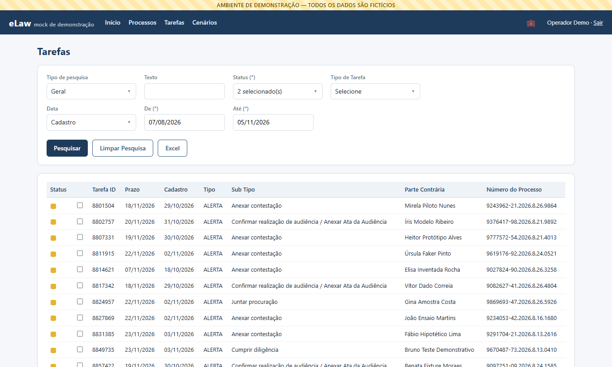
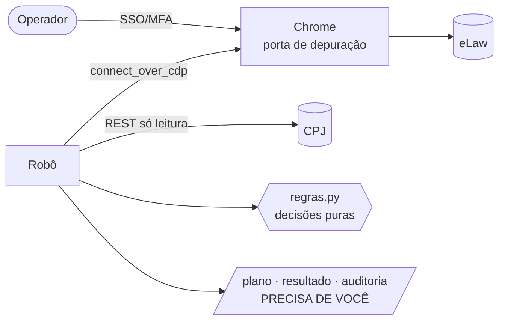
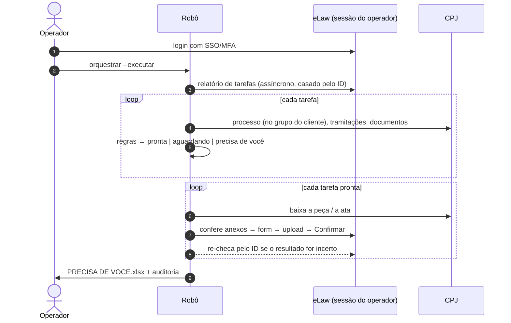
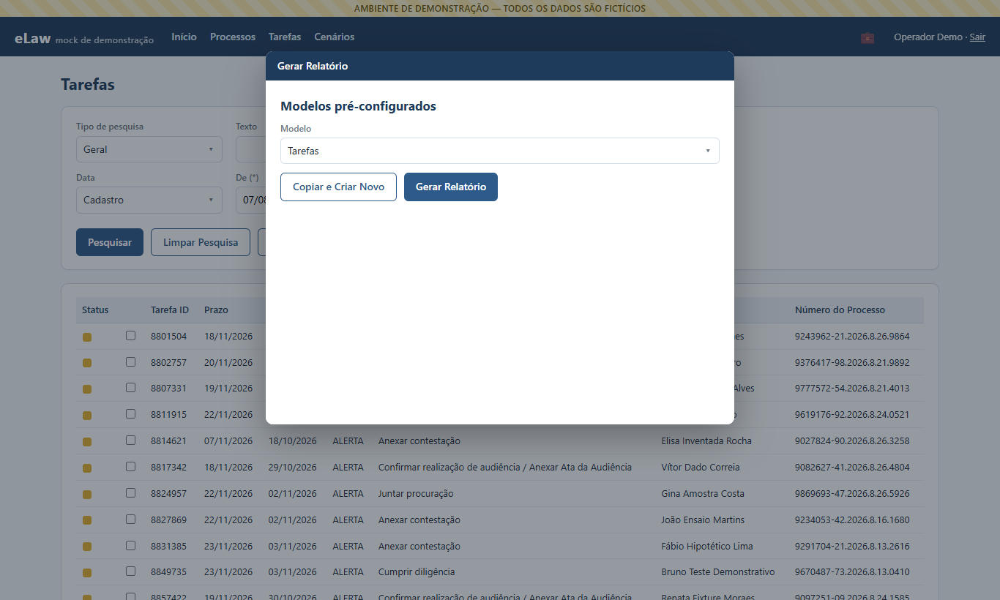
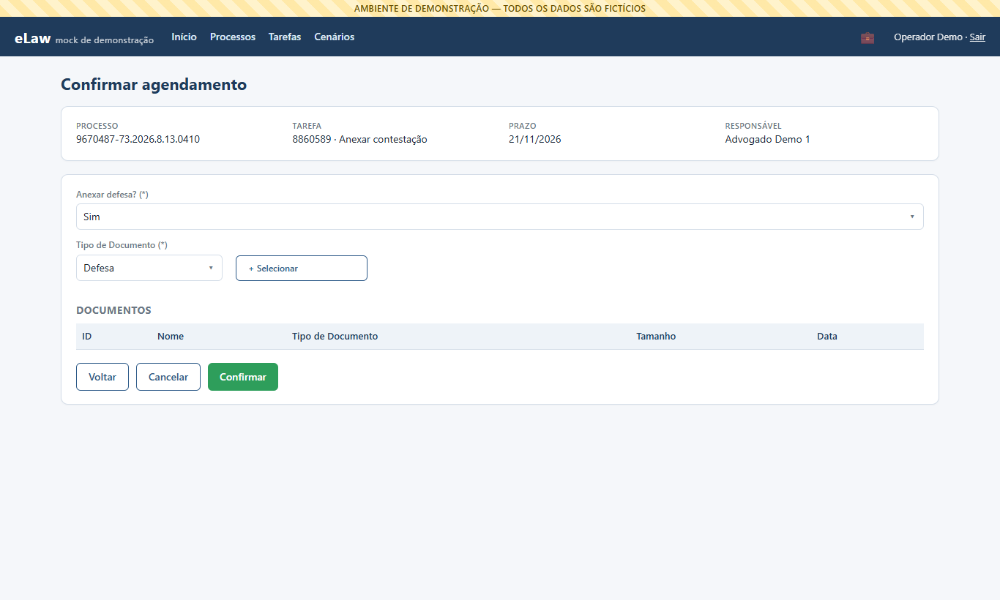

<div align="center">

# 🤖⚖️ rpa-contencioso-elaw

**Robô de RPA que conclui tarefas do contencioso no eLaw sozinho — acoplado à sessão que o operador abriu com SSO/MFA, cruzando os dados com a API do CPJ.**

[](https://www.python.org/)
[](https://playwright.dev/python/)
[](https://fastapi.tiangolo.com/)
[](https://docs.pytest.org/)
[](LICENSE)
[](#-o-mock-executável)

</div>

> [!NOTE]
> Esta é uma **versão sanitizada, para portfólio**, de uma automação que roda em produção num escritório
> de advocacia. O código foi reescrito do zero mantendo a arquitetura e as decisões de engenharia; **todos os
> dados são fictícios** (processos, partes, IDs, tipos, credenciais). O repositório traz um **mock executável**
> do eLaw e do CPJ para o robô rodar ponta a ponta em qualquer máquina, com um comando.

---

## 📑 Sumário

- [O problema](#-o-problema)
- [A solução](#-a-solução)
- [Funcionalidades](#-funcionalidades)
- [Quickstart](#-quickstart)
- [Como funciona](#-como-funciona)
- [Regras de decisão](#-regras-de-decisão)
- [Decisões de engenharia e lições aprendidas](#-decisões-de-engenharia-e-lições-aprendidas)
- [O mock executável](#-o-mock-executável)
- [Referência da CLI](#-referência-da-cli)
- [Códigos de saída](#-códigos-de-saída)
- [Estrutura do projeto](#-estrutura-do-projeto)
- [Testes](#-testes)
- [Roadmap](#-roadmap)
- [Licença](#-licença) · [Autor](#-autor)

---

## 🧩 O problema

A equipe jurídica de um cliente do setor financeiro recebe, todos os dias, centenas de tarefas no **eLaw**
(plataforma de gestão do contencioso do cliente) — principalmente duas:

1. **"Anexar contestação"** — pegar a peça pronta no sistema interno do escritório (**CPJ**), anexar no
   processo certo do eLaw e concluir a tarefa;
2. **"Confirmar realização de audiência / Anexar Ata"** — informar se a audiência foi frutífera ou
   infrutífera e anexar a ata.

É trabalho repetitivo, com prazo, em duas telas diferentes, e cheio de armadilhas: peça anexada no
processo errado, o mesmo número de processo cadastrado para dois clientes, resultado de audiência antiga
confundido com o da nova, tarefa concluída por um colega no meio do caminho…

E há um bloqueio técnico de saída: **o eLaw só é acessado com SSO + MFA corporativo**. Um robô
"tradicional", que abre o próprio navegador e faz login, não passa dessa tela — e guardar senha/segredo de
MFA num robô não é uma opção aceitável.

## 💡 A solução

**O operador autentica uma vez; o robô trabalha na sessão dele.**

```text
[operador]  abre o Chrome do robô (porta de depuração) e entra no eLaw com SSO/MFA — como sempre
[robô]      acopla nesse Chrome via CDP (Playwright connect_over_cdp) e reaproveita a sessão
            -> nunca vê senha nem código de MFA; se a sessão cair, PARA e avisa (não tenta logar)
[robô]      gera o relatório de tarefas no eLaw, consulta o CPJ (só leitura), decide tarefa a tarefa,
            conclui as prontas e devolve ao operador só o que precisa de um humano — em português
```

O resultado de cada rodada é uma planilha **"PRECISA DE VOCÊ"** com poucas linhas e uma frase do que fazer
em cada uma ("a contestação anexada no CPJ é de outro processo — corrija o cadastro"), mais trilha de
auditoria completa para o suporte.

<p align="center"></p>

## ✨ Funcionalidades

- 🔐 **Zero login no robô** — acoplamento CDP à sessão do operador; detecção de sessão expirada (código 2).
- 🧭 **Seletores à prova de JSF/PrimeFaces** — sufixo de id estável, texto e papel; nunca `j_id_*`.
- 📊 **Relatório assíncrono** — pede no modal, acompanha "Meus Relatórios" e baixa **o arquivo da própria
  solicitação** (casado pelo ID), com download redirecionado via CDP.
- 📄 **Parser de xlsx resiliente** — acha a linha do cabeçalho sozinho, mapeia colunas por apelidos e cai
  para regex de número CNJ quando a coluna some.
- 🔗 **Cliente REST do CPJ** — somente leitura, token Bearer, paginação, retry em 401/429/5xx com
  `Retry-After`, e a regra de ouro: **erro nunca vira "não encontrado"**.
- 🧠 **Regras de negócio puras e testadas** — duas filas, travas contra PDF de outro processo e contra
  resultado de audiência antiga, reagendamento por prazo.
- 🛡️ **Escrita defensiva** — dry-run por padrão, proteção contra anexo órfão/duplicado, re-checagem do
  status pelo ID quando o resultado é incerto, aborto após N erros seguidos.
- 🗂️ **Rastreabilidade** — `plano.csv`, `resultado.csv`, `auditoria.jsonl`, `log.txt` e
  `PRECISA DE VOCE.xlsx` por execução.
- 🧪 **Mock executável** — eLaw + CPJ fictícios num único FastAPI, com as armadilhas reais reproduzidas.

## 🚀 Quickstart

Requisitos: **Python 3.12+** e **Google Chrome** instalado (ou o Chromium do Playwright).

```bash
git clone https://github.com/Gabwasch/rpa-contencioso-elaw.git
cd rpa-contencioso-elaw
pip install -r requirements.txt
python demo.py
```

A demo sobe o mock, abre um Chrome **isolado** (perfil temporário, porta 9322 — nenhuma outra janela é
tocada), faz o passo humano do login, roda o robô em dry-run e depois executando, simula a queda da sessão e
mostra o resumo:

```text
[humano] login feito pelo operador — no mundo real o robô nunca digita senha (SSO/MFA corporativo).
...
  11  concluídas pelo robô
   1  já concluídas por outra pessoa
   3  aguardando (o robô tenta de novo amanhã)
   5  PRECISAM DE VOCÊ  (lista em português para o operador)
DEMO OK
```

| Opção | Efeito |
|---|---|
| `python demo.py --headless` | sem janela do Chrome |
| `python demo.py --passo-a-passo` | robô em câmera lenta, para assistir |
| `python demo.py --sem-cenario-sessao` | pula o cenário de sessão expirada |

Sem Chrome instalado? `python -m playwright install chromium` e a demo usa o Chromium do Playwright.

## 🔍 Como funciona





Mais diagramas (módulos, árvore de decisão, o mock) em **[docs/arquitetura.md](docs/arquitetura.md)**.

## 🧠 Regras de decisão

As regras vivem em [`robo/elaw/regras.py`](robo/elaw/regras.py) — código puro, sem navegador nem rede.

**Fila "Anexar contestação"**

| Situação no CPJ | Decisão | Ação no eLaw |
|---|---|---|
| tarefa "Anexar contestação no eLaw" concluída | `pronta` / `concluir_ja_anexada` | "Anexar defesa? = Não" + "Já anexada" |
| "Pauta - Contestação" concluída + PDF `Contestação…` / `UF - Contestação…` / `1. contestação…` | `pronta` / `anexar` | "Sim" + Tipo + upload + Confirmar |
| PDF com o nº de **outro** processo no nome | `pauta_sem_pdf` (trava) | nenhuma — **precisa de você** |
| pauta concluída, mas só e-mails, chats ou `.docx` | `pauta_sem_pdf` | nenhuma — **precisa de você** |
| pauta ainda pendente | `aguardando_peca` | nenhuma (tenta na próxima rodada) |
| processo não existe no grupo de trabalho do cliente | `nao_achado_cpj` | nenhuma — **precisa de você** |
| qualquer "sem peça" há **≥ N dias corridos** desde a entrada | `pronta` / `reagendar` | "Não" + "Prazo de contestação em curso" (o eLaw abre tarefa nova) |
| o processo **já tem** o arquivo (ou outra contestação) no eLaw | `concluida_ja_anexada` | conclui sem reenviar |

**Fila "Confirmar audiência"**

| Situação no CPJ | Decisão | Ação no eLaw |
|---|---|---|
| linha `AUDIENCIA: [REALIZADA -] FRUTIFERA` lançada **depois** da entrada da tarefa | `pronta` / `concluir_audiencia` | "Realizada = Sim" → Frutífera + ata (com acordo) |
| idem com `INFRUTIFERA` | `pronta` / `concluir_audiencia` | Infrutífera + ata (sem acordo) |
| só há resultado **anterior** à tarefa (outra audiência) | `aguardando_resultado` (trava) | nenhuma |
| sem a linha de resultado | `aguardando_resultado` | nenhuma |

A ata é o PDF anexado à própria tarefa do CPJ que traz o resultado; na falta, o PDF com o nome padrão
`Ata de audiencia - com|sem acordo - ….pdf`.

## 🎓 Decisões de engenharia e lições aprendidas

Cada item abaixo nasceu de um problema real em produção — e virou código, teste ou cenário no mock.

1. **Nunca fazer login — acoplar à sessão do operador.** SSO + MFA não se automatiza com segurança. Em vez
   de guardar segredos, o robô usa `connect_over_cdp` no Chrome que o operador autenticou. Bônus: o
   operador *vê* o robô trabalhando. Se a sessão expira no meio, o robô **para** com código 2 — tentar logar
   sozinho seria um risco de bloqueio de conta.
2. **Ids instáveis do JSF/PrimeFaces.** Ids como `j_id_4k7:tabSearchTab:txtSearch` mudam entre deploys.
   Regra: sufixo estável (`[id$=":txtSearch"]`), id realmente estável (`#btnConfirmaSim`), texto/papel
   (`get_by_role("button", name="Novo Arquivo")`), ou "linha da tabela pelo conteúdo + `[id$=":N:…"]`".
   No mock, os prefixos são **sorteados a cada início** — o robô só funciona porque segue a regra.
3. **Widgets precisam de clique real.** Mudar o `<select>` oculto do `selectOneMenu` por JS deixa o widget
   dessincronizado: o JSF responde "[Tipo de Documento] obrigatório!" ou o botão "Gerar" nunca habilita. O
   robô abre o painel e clica na opção — e confere o que ficou selecionado antes de seguir.
4. **Relatório assíncrono, casado pelo ID da solicitação.** O modal só devolve "solicitação enviada — ID N";
   o arquivo aparece minutos depois em "Meus Relatórios", **junto com relatórios antigos**. Baixar "o
   primeiro processado da lista" pegaria um arquivo velho. O robô tira um retrato dos IDs antes, lê o ID da
   confirmação e baixa exatamente aquela linha.
5. **Download via CDP não dispara o evento do Playwright.** Com `connect_over_cdp`, `expect_download` não
   chega. Solução: `Page.setDownloadBehavior` apontando para uma pasta + varredura da pasta pelo arquivo novo
   (ignorando `.crdownload`).
6. **A tela restaura a última pesquisa.** A tela de tarefas devolve os filtros da sessão anterior (inclusive
   um ID antigo e outro tipo de data) — e "Meus Relatórios" guarda a data de ontem numa aba aberta desde
   ontem. Um relatório gerado sem limpar sai filtrado por engano. O robô **sempre** clica "Limpar Pesquisa"
   antes, e confere os avisos da tela (pesquisa recusada mantém o resultado anterior na tabela).
7. **Data por JS não chega ao servidor.** O campo de data só registra o que é *digitado*: clique, Ctrl+A,
   digitação, Tab — e conferência do valor (as primeiras teclas podem se perder numa re-renderização).
8. **O upload é gravado antes do Confirmar → proteção contra órfão.** No form de conclusão, o arquivo vai
   para o GED na hora do upload. Se o Confirmar falha, fica um **anexo órfão**; re-tentar **duplica**. Antes
   de enviar, o robô lista os anexos do processo: mesmo nome (comparado sem acento — o GED os remove) ou uma
   contestação já presente → não envia e conclui como "Já anexada". Se algo falha depois do upload, o ID do
   anexo vai para a auditoria e para a lista do operador ("exclua o anexo X").
9. **Re-checagem pelo ID quando o resultado é incerto.** Form que demorou a fechar, erro depois do upload,
   linha que sumiu da ficha: em vez de adivinhar, o robô pesquisa a tarefa pelo ID e classifica como
   `concluida`, `nao_concluiu` ou `ja_concluida` (um colega concluiu antes). Com anexo, o Confirmar pode
   levar vários segundos — o robô espera até 30 s antes de desconfiar (a primeira versão dava falso negativo).
10. **Dry-run por padrão.** Nada é escrito sem `--executar`. O plano (`plano.csv`) mostra exatamente o que
    seria feito; `--limite` e `--numero` permitem pilotos controlados; o lote aborta após N erros seguidos.
11. **Mesmo número de processo em dois clientes → filtro por grupo de trabalho.** No CPJ, o mesmo CNJ pode
    ter cadastro de outro cliente do escritório. Pegar "o primeiro" lia a pasta errada. O cliente REST filtra
    pelo grupo de trabalho do cliente (há um teste que mostra o erro sem o filtro).
12. **PDF de outro processo anexado → trava por CNJ no nome.** Uma contestação foi anexada no cadastro errado
    do CPJ. Se o nome do PDF traz um número CNJ **diferente** do processo, o robô não usa a peça e pede
    correção humana.
13. **Resultado de audiência antiga → trava por data.** Só vale a linha `AUDIENCIA: …` lançada depois da
    entrada da tarefa no eLaw; um resultado anterior é de outra audiência.
14. **Erro de API nunca é "não encontrado".** Sob carga a API respondia 5xx e o processo "sumia". Agora só
    404/lista vazia significa "não existe"; qualquer outra falha (depois das novas tentativas) vira
    `CPJIndisponivel` e a tarefa fica para a próxima rodada. Login com timeout curto e novas tentativas
    (a API às vezes não responde e, segundos depois, responde em < 1 s).
15. **PyInstaller: `--onedir`, não `--onefile`.** O operador usa um executável. O `onefile` descompacta
    ~75 MB numa pasta temporária a cada abertura (5 s com cache, ~30 s na primeira do dia com antivírus); o
    `onedir` abre em ~1 s. Pequeno detalhe, grande diferença para quem abre o robô várias vezes por dia.
16. **Uma aba dirigida por outro cliente CDP pode "morrer" para o mouse.** Na demo, o login automático usa
    Playwright na mesma aba; depois que esse cliente desconecta, a aba deixa de receber cliques. A demo
    então abre uma aba limpa pela API HTTP do DevTools (`/json/new`) e fecha a antiga. No uso real isso não
    acontece — a aba do operador nunca foi dirigida por Playwright —, mas o robô também prefere a aba já
    logada e a traz para a frente.
17. **Saída para humanos, não só para máquinas.** O operador recebe uma planilha curta, em português simples;
    o suporte recebe `auditoria.jsonl` (um evento por linha) e o log. Duas audiências, dois formatos.

## 🧪 O mock executável

`python -m mock.app` sobe só o mock em `http://127.0.0.1:8701` (usuário **`operador`**, senha **`demo123`**).

| Endereço | O que é |
|---|---|
| `/login.elaw` | login local do mock (no mundo real: SSO/MFA — o robô nunca usa esta tela) |
| `/agendamentoContenciosoList.elaw` | pesquisa de tarefas (lembra a última pesquisa da sessão) |
| `/processoView.elaw?id=…` | ficha com abas "Pauta e Andamento" e "Anexos" (carregada por ajax) |
| `/__mock/cenarios` | os 21 processos fictícios e o desfecho esperado de cada um |
| `/cpj/api/v3/…` | API "parecida com a do CPJ" (credenciais fictícias em `robo/.env.exemplo`) |
| `/cpj/docs` | Swagger da API do mock |

| | |
|---|---|
|  |  |
| Modal "Gerar Relatório" (iframe; "Gerar" só habilita com clique real) | Form de conclusão da tarefa |

A massa é gerada por [`mock/seed.py`](mock/seed.py) (`random.Random(42)`), com números CNJ válidos e datas
relativas ao dia em que o mock sobe — os cenários de prazo funcionam em qualquer data.

## 📟 Referência da CLI

```bash
cd robo
python rpa_elaw.py <comando> [opções]        # sem comando = modo guiado (menu)
```

| Comando | O que faz | Escreve no eLaw? |
|---|---|---|
| `orquestrar` | rodada completa: relatório → CPJ → regras → plano | não (dry-run) |
| `orquestrar --executar [--limite N] [--numero CNJ]` | conclui as tarefas prontas | **sim** |
| `orquestrar --xlsx arquivo.xlsx` | usa um relatório já baixado | depende de `--executar` |
| `orquestrar --novo-relatorio` | ignora o relatório de hoje e gera outro | — |
| `consultar --numero CNJ [--executar]` | um processo só, lendo a ficha (segundos, sem relatório) | só com `--executar` |
| `relatorio-tarefas [--status …] [--tipo …] [--de/--ate dd/mm/aaaa]` | gera e baixa o relatório de tarefas | não |
| `anexar --numero CNJ --arquivo peca.pdf [--tipo 31] [--ensaio]` | anexo avulso na aba Anexos | **sim** (exceto `--ensaio`) |
| `buscar --numero CNJ` | pesquisa um processo | não |

Opções globais: `--config`, `--cdp URL`, `--slow-mo ms`. Credenciais do CPJ: `CPJ_LOGIN`/`CPJ_SENHA` no
ambiente ou em `robo/.env` (modelo em `robo/.env.exemplo`).

## 🚦 Códigos de saída

| Código | Significado |
|---|---|
| `0` | sucesso (itens que precisam de humano vão para `PRECISA DE VOCE.xlsx`) |
| `1` | não concluiu (anexo não confirmado) ou lote abortado por erros seguidos |
| `2` | Chrome não encontrado, eLaw não autenticado ou **sessão expirada** — faça login e rode de novo |
| `3` | o eLaw recusou: pesquisa inválida, relatório indisponível, tipo inexistente |
| `4` | (`anexar`) já existe um anexo com o mesmo nome no processo |
| `5` | processo não encontrado no eLaw |
| `6` | API do CPJ indisponível |

## 🗂️ Estrutura do projeto

```text
rpa-contencioso-elaw/
├── demo.py                  # demonstração ponta a ponta em um comando
├── robo/
│   ├── rpa_elaw.py          # CLI (subcomandos + modo guiado)
│   ├── config.toml          # padrões apontando para o mock
│   ├── .env.exemplo         # modelo de credenciais (fictícias)
│   └── elaw/
│       ├── conexao.py       # acoplamento CDP, sessão expirada
│       ├── seletores.py     # seletores por sufixo/texto
│       ├── util.py          # clique real em widgets, esperas, iframes
│       ├── cnj.py           # número CNJ (DV mod 97-10)
│       ├── regras.py        # decisões de negócio (puras)
│       ├── tarefas_xlsx.py  # parser do relatório
│       ├── cpj.py           # cliente REST do CPJ (só leitura)
│       ├── orquestrador.py  # a rodada
│       ├── saida.py         # csv, jsonl, PRECISA DE VOCE.xlsx
│       ├── guiado.py        # menu do operador
│       └── fluxos/          # processo · tarefas · relatorio · concluir · anexar
├── mock/
│   ├── app.py               # FastAPI (eLaw + CPJ) em um processo
│   ├── elaw_ui.py           # telas "parecidas com o eLaw"
│   ├── cpj_api.py           # API "parecida com a do CPJ"
│   ├── estado.py            # estado em memória
│   ├── seed.py → dados.json # massa fictícia determinística
│   ├── pdf.py               # gerador de PDF sem dependências
│   └── static/              # pf.js (mini PrimeFaces) + style.css
├── tests/                   # pytest: CNJ, regras, parser, cliente CPJ, plano com o mock
└── docs/                    # arquitetura.md + capturas do mock
```

## ✅ Testes

```bash
pip install -r requirements-dev.txt
pytest -q
```

Os testes não abrem navegador: cobrem os dígitos verificadores do CNJ, **cada desfecho** das regras, o
parser de xlsx (cabeçalho fora da linha 1, fallback por regex), o cliente do CPJ contra o próprio mock via
`TestClient` (filtro por grupo de trabalho, paginação, re-login com token vencido, retry em 503/429) e contra
uma sessão falsa (erro persistente nunca vira "não encontrado"), além de um teste de integração que passa
toda a massa fictícia pelas regras e confere o desfecho de cada cenário. O fluxo de tela é verificado pela
`demo.py`.

## 🛣️ Roadmap

- [ ] Agendamento diário com aviso (Teams/e-mail) quando a lista "PRECISA DE VOCÊ" não estiver vazia
- [ ] Painel com a evolução das filas (concluídas × aguardando × precisam de você)
- [ ] Testes de tela automatizados (Playwright contra o mock no CI)
- [ ] Suporte a mais tipos de tarefa (ex.: cumprimento de diligências)
- [ ] Empacotamento `--onedir` com assinatura e atualização automática

## 📄 Licença

[MIT](LICENSE) © 2026 Gabriel Waschburger

## 👤 Autor

**Gabriel Waschburger**
[LinkedIn](https://www.linkedin.com/in/gabriel-waschburger) · [GitHub @Gabwasch](https://github.com/Gabwasch)
