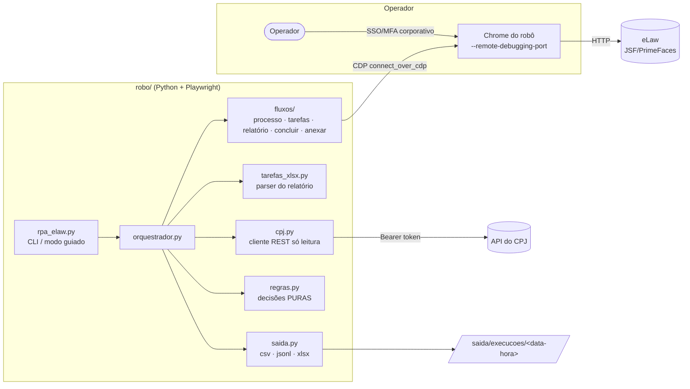
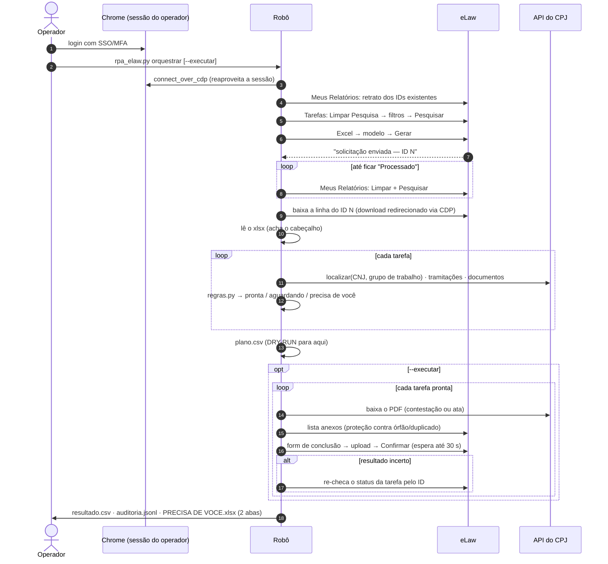
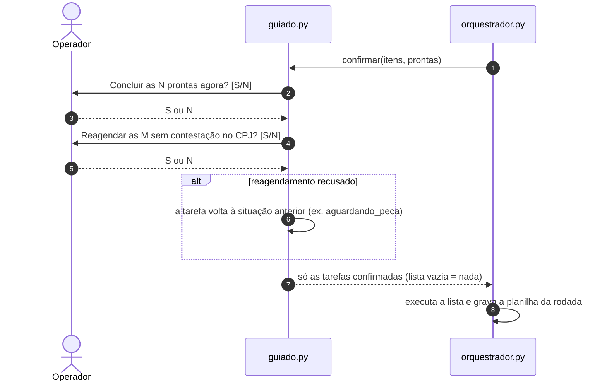
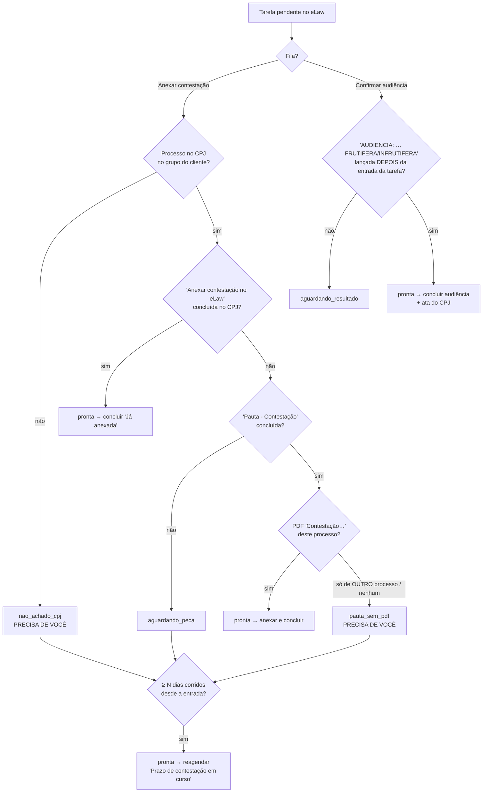

# Arquitetura

> Versão de portfólio. Todos os dados, IDs e números de processo do repositório são fictícios.

## Visão geral

O robô **não abre navegador próprio nem faz login**: ele se acopla, via Chrome DevTools Protocol, ao
Chrome em que o operador já entrou. Isso tira do robô o problema mais difícil (SSO + MFA) sem
contornar nenhum controle de segurança — a sessão continua sendo do operador, que vê tudo na tela.

## Módulos

| Módulo | Responsabilidade | Depende de navegador? |
|---|---|---|
| `elaw/cnj.py` | número CNJ: dígitos verificadores (ISO 7064 mod 97-10), formatação, extração de texto | não |
| `elaw/regras.py` | **todas** as decisões de negócio (filas, travas, reagendamento, "precisa de você") | não |
| `elaw/tarefas_xlsx.py` | acha o cabeçalho do relatório sozinho e mapeia colunas por apelidos | não |
| `elaw/cpj.py` | cliente REST: login com novas tentativas, paginação, retry 401/429/5xx | não |
| `elaw/saida.py` | `plano.csv`, `resultado.csv`, `auditoria.jsonl`, `log.txt`, `PRECISA DE VOCE.xlsx` (abas "Precisa de você" e "Feito pelo robô") | não |
| `elaw/guiado.py` | menu do operador: resumo, duas perguntas S/N (concluir / reagendar), confirmação parcial | não |
| `elaw/conexao.py` | acoplamento CDP, detecção de sessão expirada | sim |
| `elaw/seletores.py` | seletores por sufixo de id / texto (nunca `j_id_*`) | — |
| `elaw/fluxos/*` | telas: busca, ficha, tarefas, relatório assíncrono, conclusão, anexo | sim |
| `elaw/orquestrador.py` | a rodada: tarefas → CPJ → regras → plano → execução → saídas | sim (só na execução) |

A separação é deliberada: tudo o que decide fica em código puro e testável (`regras.py`), e tudo o
que clica fica nos fluxos. Os testes cobrem as regras sem abrir navegador.

## Sequência de uma rodada

## Modo guiado: confirmação em duas perguntas

No modo guiado o plano é montado em dry-run e o orquestrador chama `confirmar(itens, prontas)` antes de
executar. "Concluir as prontas" e "reagendar" são decisões separadas, então o operador responde duas
perguntas e o orquestrador executa **só a lista devolvida** — na mesma sessão, sem gerar o relatório de novo.

A planilha da rodada (`PRECISA DE VOCE.xlsx`) tem duas abas: **"Precisa de você"** (o que pede ação
humana, com a frase do que fazer) e **"Feito pelo robô"** (data da rodada, processo, tarefa, fila, o que o
robô fez, PDF e ID do anexo no GED). Tarefas que outra pessoa concluiu antes (`ja_concluida`) não entram
na aba do robô. Quando nada precisa da equipe, a planilha abre direto em "Feito pelo robô".

## Árvore de decisão

## O mock

`mock/` é um FastAPI de um processo só, com duas faces:

* **interface "parecida com o eLaw"** — telas HTML com um mini "PrimeFaces" em JS (`static/pf.js`).
  Os ids têm prefixo `j_id_*` **sorteado a cada início do servidor**, os selects só registram com
  clique real, a tela de tarefas restaura a última pesquisa, o relatório é assíncrono (3–5 s) e
  entregue em "Meus Relatórios" junto com relatórios antigos, o upload grava antes do Confirmar e
  um cenário falha de propósito no Confirmar;
* **API "parecida com a do CPJ"** em `/cpj/api/v3` — login com token Bearer que "vence" após N usos,
  envelope de paginação, filtros `filter[campo][_eq]`, 503 ocasional com `Retry-After` e documentos
  PDF gerados na hora por um gerador de PDF sem dependências (`mock/pdf.py`).

A massa (`mock/dados.json`) é gerada por `mock/seed.py` com `random.Random(42)`: 21 processos, um por
cenário de regra, com números CNJ válidos (dígitos verificadores corretos) e datas relativas ao dia
em que o mock sobe. A lista de cenários fica em `http://127.0.0.1:8701/__mock/cenarios`.
